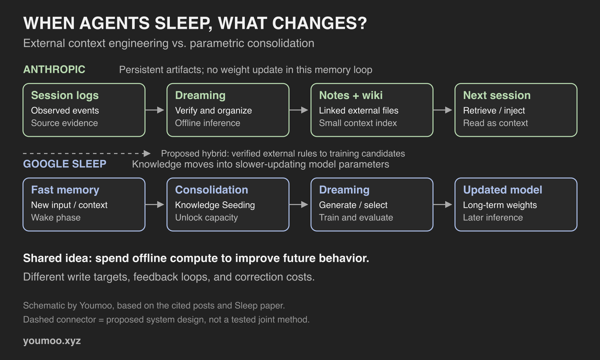

2026 年 11 月 6 日，Lance Martin 在 Anthropic 发布了 [The components of agent memory](https://www.anthropic.com/research/components-of-agent-memory)；10 月 27 日，Ali Behrouz 与 Vahab Mirrokni 在 Google Research 发布了 [The sleep framework](https://research.google/blog/the-sleep-framework-a-new-way-for-llms-to-retain-knowledge-in-continual-learning/)。后者对应论文 *Language Models Need Sleep: Learning to Self-Modify and Consolidate Memories*，作者为 Ali Behrouz、Farnoosh Hashemi、Adel Javanmard、Vahab Mirrokni，[arXiv:2606.03979](https://arxiv.org/abs/2606.03979)。

两篇都谈离线巩固，都用了 dreaming。但判断它们是不是同一种技术，要先问：**睡醒以后，究竟什么变了？**

Anthropic 改的是 Agent 下次能读到的资料；Google Sleep 改的是模型中承载知识的参数。它们处理同一个长期问题——经验如何跨越一次会话——却把经验写进了不同的地方。

*图为本文绘制的机制示意，依据两篇原文及 Sleep 论文；虚线接口属于本文的工程推演。*

## 1. 先把记忆的存储边界画出来

这里的“外部”和“内部”指知识是否进入模型参数，不是数据在本机还是云端。

| 对照项 | Anthropic 的 agent memory | Google Sleep |
|---|---|---|
| 持久载体 | 日志、笔记、wiki 等外部材料 | 长期参数模块 |
| 离线写入 | 核验、改写、组织材料 | 蒸馏、训练、更新权重 |
| 再次使用 | 检索材料或预先注入上下文 | 由更新后的模型参与推理 |
| dreaming 的主要产物 | 更可靠、更易访问的记忆表示 | 经筛选的合成训练经验与参数更新 |

这也解释了一个容易混淆的说法：“模型没有训练，所以没有学会。”如果讨论的是整个 Agent 系统，外部笔记确实可以让它在下一次任务中表现得更好；如果讨论的是模型权重，它确实没有因此发生改变。**系统层面的适应与参数层面的学习，可以同时成立，也可以分别发生。**

## 2. Anthropic：让未来的自己读对资料

Anthropic 明确把这里的 agent memory 定义为跨会话保存、以后可以读取的经验，并排除了权重更新、单次会话内的 in-context learning 和 compaction。它的层次是：**原始日志 → 记忆笔记 → wiki 等组织表示 → 每次会话预载的小量上下文**。Dreaming 可以跨层工作，检查错误、重组链接、调整哪些内容值得提前加载。[来源：Anthropic 原文](https://www.anthropic.com/research/components-of-agent-memory)

关键不是多存一份摘要，而是维护“未来怎么找到、为什么应该相信”。原始记录提供核对依据，笔记提炼经验，索引负责导航。三者的职责不能全压给一个不断变长的 Markdown 文件。

Anthropic 的 [官方 dreaming cookbook](https://platform.claude.com/cookbook/managed-agents-cma-dreaming-with-a-dynamic-workflow) 给出了具体实现：导出已结束的会话，后台分析并整理成带索引的记忆库，再让后续会话挂载读取。这个流程需要模型推理与文件操作权限，不需要调用者拿到训练权重。

我的工程理解是：这是在改造 Agent 的工作环境。把一次排障留下的散乱工具输出，变成下一次能定位到的诊断依据。效果仍取决于 Agent 是否读到它、是否理解适用条件、是否真的执行了其中的规则。

## 3. Google Sleep：让短期经验进入长期参数

Google 的 Sleep 有两个阶段：**memory consolidation** 和 **dreaming**。活跃阶段接收新信息；离线阶段把快速、易失的记忆迁往更新频率较低的模块，并进行自我改进。博客强调，系统遵循固定架构与人工定义的训练规则，解锁预分配的 MoE 记忆块；这里的参数扩展不意味着模型自行改写代码或无限生长。[来源：Google 博客](https://research.google/blog/the-sleep-framework-a-new-way-for-llms-to-retain-knowledge-in-continual-learning/)

### 巩固：增加可写容量，再转移知识

论文中的 **Knowledge Seeding** 把较短期的知识向更稳定的参数模块蒸馏。其具体方法结合 on-policy distillation 与 RL imitation learning：学生在自身采样的序列上获得教师分布反馈，并用语义及文本相似度信号学习模仿。新增可用容量为新知识提供写入空间；巩固后，快速临时模块可以重置。[来源：论文第 3.2–3.3 节](https://arxiv.org/html/2606.03979v2#S3.SS2)

“快”和“慢”主要说的是**更新频率**，不要直接对应成 GPU 显存、SSD 或文件缓存。这是学习系统内部的时间尺度。

### Dreaming：练习数据本身也要接受反馈

论文的具体实现会在生成时额外引入随机专家，产生候选“梦境”；再用梯度信息筛选样本，保留部分随机样本维持多样性。候选数据经过独立模型实例的 LoRA/SFT 试练，其下游收益用来奖励生成过程。[来源：论文第 3.4 节](https://arxiv.org/html/2606.03979v2#S3.SS4)

所以这里的 dreaming 有训练闭环。它不仅问“这段经验应该怎么表述”，还问“用这段经验训练之后，能力有没有变好”。**生成了一份自我反思，并不等于完成了 Sleep。**

## 4. 共同点：把当下记录与事后判断分开

我的判断是，两者最有价值的共同点，是允许系统在事后重新决定经验的价值。

任务执行中，系统只知道当前发生了什么；等结果出现，才知道哪个步骤是有效策略、哪个推断只是碰巧奏效。离线时间提供了重新检查的机会，也把一部分记忆维护工作移出了用户等待的路径。

两者也都需要选择。外部库不能把全部历史变成开场必读材料；参数系统同样不能假设每段新输入都值得长期巩固。选择依据分别落在任务目标、来源核验、检索结构，以及蒸馏目标、训练信号和样本筛选上。

但这个共同点不意味着计算免费。可以把账粗略写成：

**长期任务成本 = 在线推理 + 离线整理或训练 + 记忆维护 + 错误造成的返工。**

要比较方案，应该固定任务质量，再统计整个周期的成本。只比较下一轮提示词有多短，或者单次整理花了多少 token，都容易漏账。

## 5. 实验结果支持什么，又没有支持什么

Anthropic 在内部文档实验中，报告仅搜索约为 **53%**，搜索配合逐渐完善的 wiki 可到 **61%**，仅 wiki 的最好成绩为 **48%**。这里衡量的是指定问题集的评分标准覆盖情况；它支持的是表示与搜索可以互补，不能读成“wiki 取代了原始资料”。[来源：Anthropic 文档实验](https://www.anthropic.com/research/components-of-agent-memory)

Google 报告了持续翻译、事实注入和数学等实验，并在 **BABILong** 上展示最高 **10M tokens** 的长上下文知识保留。这是相应任务和处理流程下的结果，不能外推成任意千万 token 都能无损写入权重，也不是商业聊天产品已经获得千万 token 原生注意力窗口的声明。[来源：Google 实验概述](https://research.google/blog/the-sleep-framework-a-new-way-for-llms-to-retain-knowledge-in-continual-learning/)

两组数字无法排出谁的记忆更强：一边主要评估 Agent 借助外部表示完成任务，另一边评估参数巩固后的能力。模型、任务、计算预算和评分口径都不同。

真正值得补做的对照，是让同一类工程任务分别使用日志检索、整理后的外部记忆、参数适应，以及混合方案；把离线算力、更新时间和旧任务回归一起计入。**目前的证据支持各自机制的可行性，还没有给出统一预算下的总冠军。**

## 6. 对工程 Agent：哪些知识留在外面，哪些值得学进去

以下是本文的设计建议，不是两篇论文已验证的联合方案。

我会用两个维度分流知识：**变化频率**与**出错后是否必须追溯原文**。

某个工艺版本的规则、当前项目的约束、昨天的工具报错，优先留在外部系统。记录版本、来源与适用条件，变化后可以局部撤销。跨项目反复验证的诊断方法，才是参数学习的候选：它需要在不同环境中复现，而不是仅在一份日志里看起来很聪明。

例如，Agent 发现某次时序回归与工具版本切换相关。立刻值得保存的是“哪个版本、哪个设计、哪条命令、什么报告支持这个判断”。真正可能泛化的知识，是如何排查版本变化对约束解析的影响。**具体项目事实与通用诊断技能，应该有不同的晋升门槛。**

这条路径可以分为四步：

1. **记录证据。** 工具输出与环境版本先留下，推断单独标注。
2. **离线核验。** 把可复现结论整理成带来源的外部规则；矛盾与失效条件一起保留。
3. **建立候选训练集。** 只选跨任务成立的经验，加入反例和适用边界。
4. **验证参数更新。** 新任务收益与旧任务回归同时过关，再部署可回滚的模型版本。

即使最后一步成功，原始证据仍有保留价值。模型能熟练给出建议，与它能指出建议来自哪个版本的报告，是两个不同要求。删除一份外部笔记也不代表相应知识已从训练后的权重消失；参数学习增加了一套独立的版本、撤回和验证责任。

对只能调用模型 API 的团队，前三步已经可以形成有用的记忆系统；复现 Google Sleep 的具体机制还需要模型内部模块、参数与训练流程的控制权。给托管 Agent 加一个 nightly cron，可以实现后台整理，不能据此声称复现了参数巩固。

## 7. 我会怎样判断一个记忆系统是否真的进步

文件数、摘要长度、训练步数，都不是最终验收标准。对于长期运行的工程助手，我更关心：

- **复用：** 相似问题再来时，是否减少重复探索，且结论仍正确？
- **纠错：** 一个旧结论被推翻后，多久能停止影响后续任务？
- **保留：** 学会新任务后，哪些旧能力下降了？
- **追溯：** 能否定位关键事实的来源、版本与适用范围？
- **总成本：** 把后台工作与返工算进去，是否仍节省时间和资源？

Anthropic 与 Google 把离线计算接到了记忆链条的不同位置：一个改善经验的可访问性，一个研究经验如何成为参数中的长期能力。工程上真正值得做的，是让知识沿着**证据、规则、能力**逐级晋升，并在每次晋升时验证收益、保留纠错入口。

---

— Youmoo（㕛木）

*Solid as teak.*
